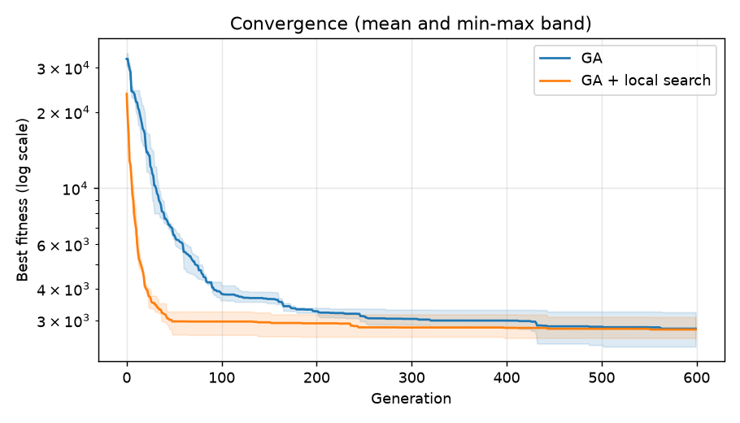
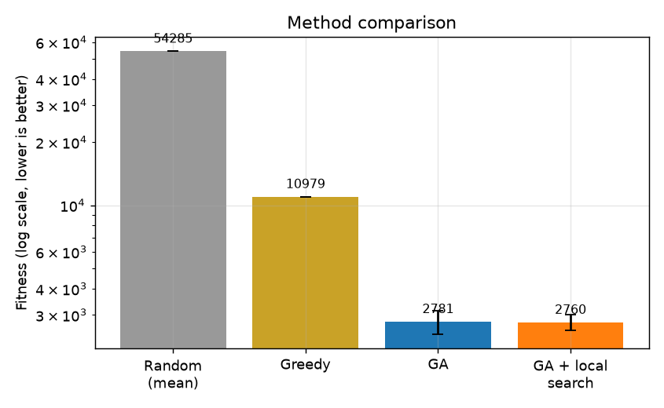
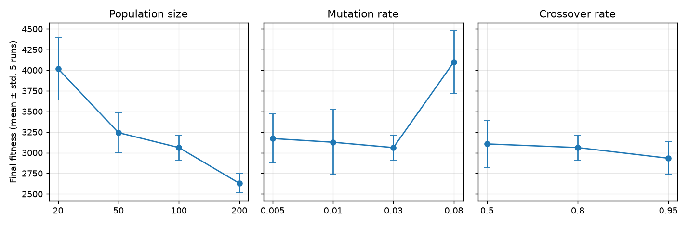
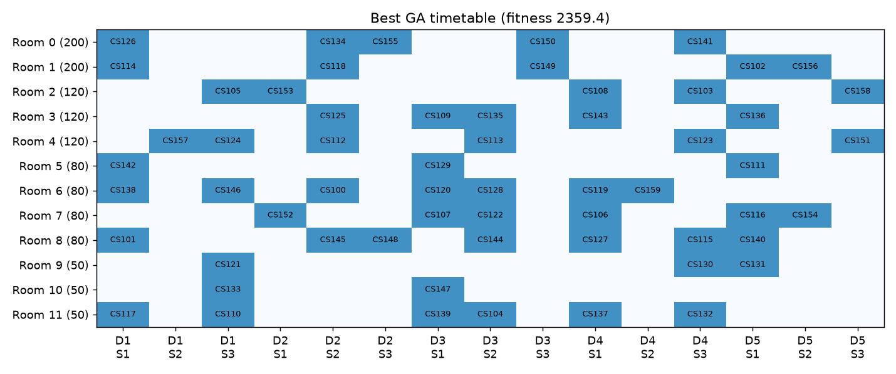
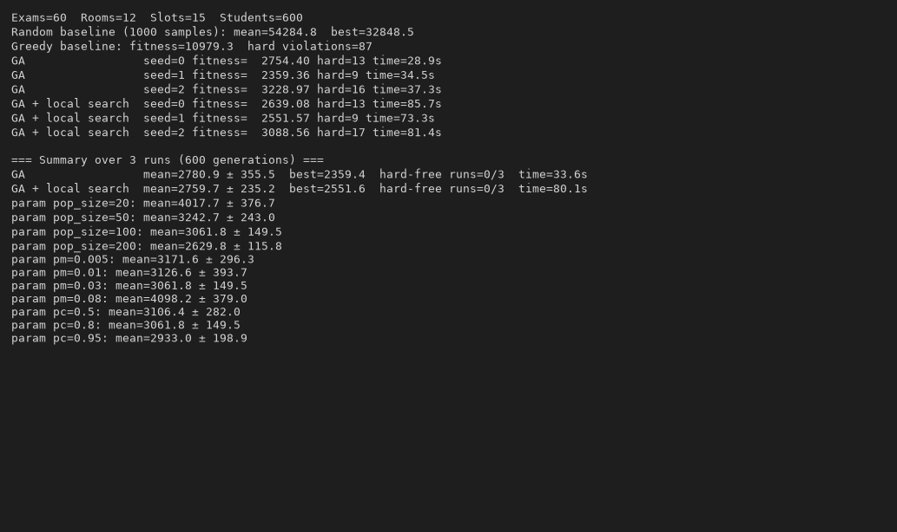

# Exam Timetabling using a Genetic Algorithm

## Problem Statement
Every semester, a university must schedule final exams so that students can sit
all of their exams without conflicts. This is a constrained combinatorial
optimization problem: the number of possible timetables grows exponentially with
the number of exams, so exhaustive search is impossible.

**Given**
- N exams, each with a number of enrolled students
- A set of students and the exams each of them takes
- R rooms with fixed capacities
- T timeslots (5 days x 3 slots per day = 15 slots)

**Decision:** assign every exam to one (timeslot, room) pair.

**Hard constraints** (must be satisfied for the timetable to be valid)
1. No student has two exams in the same timeslot.
2. Two exams cannot use the same room in the same timeslot.
3. An exam's room must have enough capacity for all its students.

**Soft constraints** (to be minimized)
1. Students should not have back-to-back exams in the same day.
2. Students should not have more than 2 exams on one day.
3. Large exams should be scheduled earlier in the exam period.

**Objective:** minimize the weighted penalty

    fitness = 100*clashes + 100*room_conflicts + 50*capacity_violations
              + 2*back_to_back + 5*day_overload + 1*late_big_exams

A fitness of 0 would be a perfect timetable.

## Technique
A **Genetic Algorithm (GA)**: each chromosome is a full timetable, i.e. an array
of (timeslot, room) genes, one per exam. The GA uses tournament selection,
uniform crossover, gene + swap mutation and elitism. An optional local-search
step (`memetic=True`) refines the best individuals each generation and is
compared against the plain GA.

## Dataset
Synthetic, generated by `data/generate_dataset.py` (seed = 42, reproducible).
- 60 exams, 600 students, 6 programmes, 12 rooms, 15 timeslots
- Each programme has 8 core exams; each student takes 4 of their programme's
  core exams plus 1-2 exams from a shared pool of 12 electives
- Room capacities: 2x200, 3x120, 4x80, 3x50

| File | Columns |
|---|---|
| `exams.csv` | exam_id, course_code, size |
| `enrollments.csv` | student_id, exam_id |
| `rooms.csv` | room_id, capacity |

## Project Structure
```
exam-timetabling-ga/
├── README.md
├── requirements.txt
├── run_experiments.py
├── data/generate_dataset.py
├── src/timetabling.py
├── results/
└── screenshots/
```

## Installation
Requires Python 3.9 or newer.

1. Clone the repository
   ```
   git clone https://github.com/VS-00/exam-timetabling-ga.git
   cd exam-timetabling-ga
   ```
2. (Optional) create a virtual environment
   ```
   python -m venv venv
   venv\Scripts\activate
   ```
3. Install dependencies
   ```
   pip install -r requirements.txt
   ```
4. Generate the dataset
   ```
   python data/generate_dataset.py
   ```
5. Run all experiments (about 10 minutes)
   ```
   python run_experiments.py
   ```

Outputs are saved to `results/results.json`, `results/best_timetable_ga.csv`
and the plots in `screenshots/`.


## Results

Main experiment: 600 generations, population 100, crossover 0.8, mutation 0.03,
3 independent runs per method (seeds 0-2). Lower fitness is better.

| Method | Mean fitness | Std | Best run | Hard violations per run | Time per run |
|---|---|---|---|---|---|
| Random (1000 samples) | 54,284.8 | - | 32,848.5 | - | - |
| Greedy (largest-degree-first) | 10,979.3 | - | 10,979.3 | 87 | < 1 s |
| **Genetic Algorithm** | **2,780.9** | 355.5 | **2,359.4** | 13 / 9 / 16 | 33.6 s |
| GA + local search (memetic variant) | 2,759.7 | 235.2 | 2,551.6 | 13 / 9 / 17 | 80.1 s |

Compared with the baselines, the GA's mean fitness is about 94.9% lower than random
scheduling and about 74.7% lower than the greedy heuristic.

Per-run results:

| Seed | GA fitness | GA hard violations | GA + LS fitness | GA + LS hard violations |
|---|---|---|---|---|
| 0 | 2,754.40 | 13 | 2,639.08 | 13 |
| 1 | 2,359.36 | 9 | 2,551.57 | 9 |
| 2 | 3,228.97 | 16 | 3,088.56 | 17 |

Parameter study (one parameter varied at a time, 300 generations, 5 runs each,
mean final fitness ± std; defaults: population 100, crossover 0.8, mutation 0.03):

| Population size | Fitness | Mutation rate | Fitness | Crossover rate | Fitness |
|---|---|---|---|---|---|
| 20 | 4,017.7 ± 376.7 | 0.005 | 3,171.6 ± 296.3 | 0.5 | 3,106.4 ± 282.0 |
| 50 | 3,242.7 ± 243.0 | 0.01 | 3,126.6 ± 393.7 | 0.8 | 3,061.8 ± 149.5 |
| 100 | 3,061.8 ± 149.5 | 0.03 | 3,061.8 ± 149.5 | 0.95 | 2,933.0 ± 198.9 |
| 200 | 2,629.8 ± 115.8 | 0.08 | 4,098.2 ± 379.0 | | |

The best GA timetable is saved in `results/best_timetable_ga.csv`
(columns: exam_id, timeslot, room, size) and all raw numbers are in `results/results.json`.

## Screenshots

**Convergence of the GA and the GA + local search variant**


**Comparison with the baselines**


**Parameter study**


**Best timetable found by the GA** (rows = rooms, columns = day and slot)


**Console output of `run_experiments.py`**


## Performance Analysis

**1. The GA clearly beats both baselines.** Random scheduling averages a fitness of
about 54,285 and the greedy heuristic reaches 10,979 with 87 hard violations. The GA
averages 2,781 with 9 to 16 hard violations, so it removes most of the conflicts that
the greedy method leaves behind. Elitism keeps the best individual in every
generation, so the best-fitness curve never increases.

**2. The GA does not fully reach a valid timetable.** None of the runs reached zero
hard violations (0/3 for both methods). The final timetables still contain 9 to 17
hard-constraint violations out of a total of 3,311 student enrolments, so they are
good but not yet conflict-free. This is the main limitation of the current
configuration.

**3. Local search did not give a significant benefit.** The memetic variant's mean
fitness (2,759.7) differs from the plain GA's (2,780.9) by only 0.8%, which is far
smaller than the run-to-run standard deviation (about 235 to 355). It was better on
seeds 0 and 2 and worse on seed 1. It also took about 2.4 times longer per run (80.1 s
versus 33.6 s). With only 3 runs we cannot claim a real difference, and on this
problem the extra cost was not justified.

**4. Population size matters most.** Fitness improved steadily as the population grew
(4,018 at 20, 3,243 at 50, 3,062 at 100, 2,630 at 200). A larger population keeps
more diversity but also costs proportionally more fitness evaluations per
generation, so this is not a cost-neutral comparison.

**5. Mutation rate has a sweet spot.** Rates from 0.005 to 0.03 performed
similarly (their differences are within one standard deviation), while 0.08 was
clearly worse (4,098). A high rate disrupts good timetables faster than selection
can repair them.

**6. Crossover rate had little effect.** Values from 0.5 to 0.95 give results that
overlap within one standard deviation, with 0.95 slightly better on average (2,933).

**7. Limitations.** The dataset is synthetic. The main comparison uses only 3 runs, so
the standard deviations are rough estimates. The parameter study uses fewer
generations (300) than the main experiment (600), so its values are not directly
comparable with the main table.

## References

1. J. H. Holland, *Adaptation in Natural and Artificial Systems*, University of Michigan Press, 1975.
2. D. E. Goldberg, *Genetic Algorithms in Search, Optimization and Machine Learning*, Addison-Wesley, 1989.
3. A. E. Eiben and J. E. Smith, *Introduction to Evolutionary Computing*, 2nd ed., Springer, 2015.
4. M. W. Carter, G. Laporte and S. Y. Lee, "Examination timetabling: Algorithmic strategies and applications," *Journal of the Operational Research Society*, vol. 47, no. 3, pp. 373-383, 1996.
5. R. Qu, E. K. Burke, B. McCollum, L. T. G. Merlot and S. Y. Lee, "A survey of search methodologies and automated system development for examination timetabling," *Journal of Scheduling*, vol. 12, no. 1, pp. 55-89, 2009.
6. P. Moscato, "On evolution, search, optimization, genetic algorithms and martial arts: Towards memetic algorithms," Caltech Concurrent Computation Program, Report 826, 1989.
7. C. R. Harris et al., "Array programming with NumPy," *Nature*, vol. 585, pp. 357-362, 2020.
8. J. D. Hunter, "Matplotlib: A 2D graphics environment," *Computing in Science & Engineering*, vol. 9, no. 3, pp. 90-95, 2007.
9. W. McKinney, "Data structures for statistical computing in Python," *Proceedings of the 9th Python in Science Conference*, 2010.